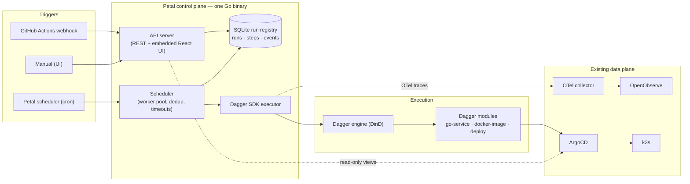

# Petal 🌸

Homelab internal developer platform: a control plane for modular CI/CD pipelines
built on Dagger, replacing Backstage.

**Principle:** *Dagger executes, Petal decides and remembers.* Petal schedules,
deduplicates, records, and reports pipeline runs; the pipelines themselves are
independent [Dagger](https://dagger.io) modules; GitHub Actions stays the
trigger layer; ArgoCD stays the deploy layer; OpenObserve (via the existing
OTel collector) is the telemetry sink.

## Architecture



See [docs/adr/0001-architecture.md](docs/adr/0001-architecture.md) for the
decision log.

## Quickstart (dev on Windows)

Two terminals — Go API on `:8080`, Vite dev server on `:5173` (proxies `/api`):

```powershell
# Terminal 1 — control plane
go run .

# Terminal 2 — frontend with hot reload
cd web
npm install   # first time only
npm run dev
```

Open http://localhost:5173 and trigger a run (Phase A ships the stub executor —
runs complete after ~1.5s; use args `{"simulate":"failure"}` to see failures).

### Real pipelines (Dagger executor)

```powershell
go run . -executor dagger -workdir .   # requires a running Docker/Podman
```

Pipeline `docker-image` builds this repo's Dockerfile and publishes it — by
default to an ephemeral [ttl.sh](https://ttl.sh) ref (no credentials needed),
overridable with args `{"ref": "ghcr.io/you/petal:dev"}`. **Dogfood:
Petal builds Petal.**

### Production build (single container)

```powershell
npm run build --prefix web   # writes web/dist, embedded into the binary
go build -trimpath -ldflags "-s -w" -o petal.exe .
docker build -t petal .      # or: docker compose -f deploy/compose.yaml up --build
```

The container is a distroless static image (~20MB) — no OS packages, no shell.

## API

| Method | Path | Description |
|---|---|---|
| GET | `/api/health` | Liveness probe |
| GET | `/api/runs?limit=50` | Recent runs |
| POST | `/api/runs` | Trigger a run: `{"pipeline":"docker-image","module_fn":"build","args":{}}` — optional `dedup_key` for at-least-once dedup |
| GET | `/api/runs/{id}` | Run detail + audit events |

## Layout

```
main.go              # entrypoint; go:embed of web/dist
internal/
  api/               # HTTP handlers (same-origin UI — no CORS anywhere)
  runs/              # SQLite run registry (traceability spine)
  scheduler/         # worker pool: claim → execute → record
  executor/          # Executor interface; stub (Phase A), Dagger (next)
web/                 # Vite + React + Mantine frontend
pipelines/           # Dagger modules (one per language/task family) — upcoming
deploy/compose.yaml  # local container run
docs/adr/            # architecture decision records
```

## Phases

- [x] **A — walking skeleton**: binary + UI + registry + manual trigger + stub executor
- [ ] **B — brains**: ~~Dagger executor~~ ✅ · GHA webhook receiver · cron scheduler · standalone pipeline modules
- [ ] **C — senses**: OTel wiring, health dashboard, metrics
- [ ] **D — catalog**: ArgoCD/K8s views, scorecards, notifications
