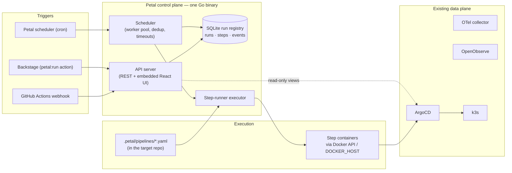

# Petal 🌸

Homelab pipeline orchestrator: a control plane for repo-native CI/CD
pipelines. **Backstage is the portal; Petal is the orchestrator** — Backstage
triggers Petal runs, Petal executes and remembers them
([ADR 0003](docs/adr/0003-backstage-portal-petal-orchestrator.md)). The portal
role moves into Petal incrementally.

**Principle:** *Petal decides and remembers; Docker runs; YAML describes.*
Petal schedules, deduplicates, records, and reports pipeline runs; pipelines
are declarative YAML files committed to the repository being built
(`.petal/pipelines/*.yaml`) and execute as plain Docker containers;
GitHub Actions stays the trigger layer; ArgoCD stays the deploy layer;
OpenObserve (via the existing OTel collector) is the telemetry sink.

## Architecture



See [ADR 0001](docs/adr/0001-architecture.md),
[ADR 0002](docs/adr/0002-step-runner.md) and
[ADR 0003](docs/adr/0003-backstage-portal-petal-orchestrator.md) for the
decision log.

## Pipelines

A repository gets pipelines by committing YAML files — zero Petal-side config:

```yaml
# .petal/pipelines/docker-image.yaml
name: docker-image
description: Build and publish the project container image

params:
  ref:
    default: ttl.sh/petal-${PETAL_RUN_ID}:1h

steps:
  - name: build
    image: docker:27-cli
    run: |
      docker buildx build --tag "$PARAM_REF" --push /src

outputs:
  image-ref: .petal-out/image-ref.txt
```

Rules (full spec in ADR 0002):

- Steps run **sequentially, fail-fast**, each in a fresh container from
  `image` (pinned tags required, `latest` rejected), workspace bind-mounted
  at `/src` (a per-run snapshot of the repo — steps never race git-sync).
- `run` executes with `sh -c "set -eu"`; logs stream to
  `<data>/logs/<run_id>/<step>.log`.
- Every step gets `PARAM_*` for each param, plus `PETAL_RUN_ID`,
  `PETAL_PIPELINE`, `PETAL_STEP`, `PETAL_TRIGGER`, `PETAL_ARGS_JSON`, and
  `DOCKER_HOST` (for image-building steps).
- `outputs` files are read after success and recorded as the run's output
  event.
- The executor talks the Docker Engine API (`DOCKER_HOST` — the DinD sidecar
  on k3s, the mounted socket under compose). No engine, no SDK, no docker CLI.

The `stub` executor (`-executor stub`, the default) simulates runs without
Docker — handy for UI development; `{"simulate":"failure"}` exercises failure
paths.

## Quickstart (dev on Windows)

Two terminals — Go API on `:8080`, Vite dev server on `:5173` (proxies `/api`):

```powershell
# Terminal 1 — control plane
go run .

# Terminal 2 — frontend with hot reload
cd web
npm install   # first time only
npm run dev
```

Open http://localhost:5173. The UI is a read-only console; trigger runs through
the API (set `PETAL_API_TOKEN` first):

```powershell
$env:PETAL_API_TOKEN = "dev"; go run .
curl -X POST localhost:8080/api/runs -H "Authorization: Bearer dev" -d '{"pipeline":"docker-image"}'
```

### Real pipelines

Steps are Linux containers, so on a Windows dev box run Petal itself as a
Linux container — same image as production, sibling step containers via the
mounted daemon socket:

```powershell
docker compose -f deploy/compose.yaml up --build -d
# UI on http://localhost:8080 — executor is steps, workdir mounted at /src
```

On Linux/WSL2 (and the k3s deployment), the binary runs directly against a
daemon:

```powershell
go run . -executor steps -workdir .
```

Pipeline `docker-image` (in this repo's `.petal/pipelines/`) builds the workdir
Dockerfile and publishes it — by default to an ephemeral
[ttl.sh](https://ttl.sh) ref (no credentials needed), overridable with args
`{"ref": "ghcr.io/you/petal:dev"}`. **Dogfood: Petal builds Petal.**

### Production build (single container)

```powershell
npm run build --prefix web   # writes web/dist, embedded into the binary
go build -trimpath -ldflags "-s -w" -o petal.exe .
docker build -t petal .      # or: docker compose -f deploy/compose.yaml up --build
```

The container is a distroless static image (~20MB) — no OS packages, no shell.

## API

| Method | Path | Description |
|---|---|---|
| GET | `/api/health` | Liveness probe |
| GET | `/api/pipelines` | Pipeline catalog discovered in the workdir |
| GET | `/api/runs?limit=50` | Recent runs; filters `pipeline=`, `trigger_kind=`, `repo=`, `source=` (trigger_source prefix, e.g. `backstage:component:default/petal%23`) |
| POST | `/api/runs` | 🔒 Trigger a run: `{"pipeline":"docker-image","args":{}}` — optional `trigger_kind` (`api`\|`backstage`), `trigger_source`, `dedup_key`, and `repo` (allowlist alias) + `ref` (branch/tag/SHA, default the repo's `default_ref`) for a multi-repo run (ADR 0004). Self-repo unknown pipeline → 404; unknown repo / bad ref → 400 |
| GET | `/api/repos` | Multi-repo allowlist (`-repos` file): alias, URL, default ref |
| GET | `/api/runs/{id}` | Run detail + audit events (step.started / step.finished / output) |
| GET | `/api/runs/{id}/logs/{step}` | Step log (text/plain, live while the step runs) |
| POST | `/api/triggers/github` | Signed webhook (HMAC-SHA256, header `X-Petal-Signature`) for CI triggers; enables with `PETAL_TRIGGER_TOKEN` env; dedups on `git_sha:pipeline` |
| GET | `/api/schedules` | List cron schedules |
| POST | `/api/schedules` | 🔒 Create a schedule: `{"pipeline":"docker-image","cron":"*/15 * * * *","args":{}}` |
| DELETE | `/api/schedules/{id}` | 🔒 Delete a schedule |
| POST | `/api/schedules/{id}/toggle` | 🔒 Enable/disable a schedule |

🔒 = requires `Authorization: Bearer $PETAL_API_TOKEN`. With no token
configured these endpoints return 503 — an open port never means an open
trigger. Reads stay open on the LAN (ADR 0003).

### Wiring GitHub Actions → Petal

`.github/workflows/petal-trigger.yaml` sends a signed trigger on every push to
`main`. To activate:

1. Generate a token: `openssl rand -hex 32`, run Petal with
   `PETAL_TRIGGER_TOKEN=<token>`
2. In the GitHub repo: **Settings → Secrets and variables → Actions** — add
   secrets `PETAL_URL` (where Petal is reachable from runners) and
   `PETAL_TRIGGER_TOKEN`, and set variable `PETAL_ENABLED=true`
3. Push — the run appears in Petal with trigger `webhook` and the GHA run URL
   as its source

## Layout

```
main.go                       # entrypoint; go:embed of web/dist
internal/
  api/                        # HTTP handlers (same-origin UI — no CORS anywhere)
  pipeline/                   # spec loader: .petal/pipelines/*.yaml → validated Pipeline
  runs/                       # SQLite run registry (traceability spine)
  scheduler/                  # worker pool: claim → execute → record
  executor/                   # Executor interface; stub, steps (Docker API)
web/                          # Vite + React + Mantine frontend
.petal/pipelines/             # this repo's own pipelines (dogfood)
deploy/compose.yaml           # local container run
docs/adr/                     # architecture decision records
```

## Phases

- [x] **A — walking skeleton**: binary + UI + registry + manual trigger + stub executor
- [x] **B — brains**: ~~GHA webhook receiver~~ ✅ · ~~cron scheduler~~ ✅ · repo-native pipeline spec + step-runner executor (ADR 0002) ✅
- [x] **Orchestrator contract** (ADR 0003): bearer-token API, trigger provenance, run filters, read-only console
- [x] **Backstage integration**: `petal:run` scaffolder action, "Run a Petal pipeline" template with a live pipeline picker, "Petal runs" entity card (Homelab repo, 2026-10-23)
- [x] **Multi-repo runs** (ADR 0004): `repo@ref` per run, cloned in a throwaway `alpine/git` container, allowlist file (`-repos`), resolved commit recorded
- [ ] **C — senses**: OTel wiring, health dashboard, metrics
- [ ] **D — catalog**: ArgoCD/K8s views, scorecards, notifications
- [ ] **v2 executor ideas**: `uses:` step library (`.petal/steps/*.yaml`), petal CLI scaffolding
