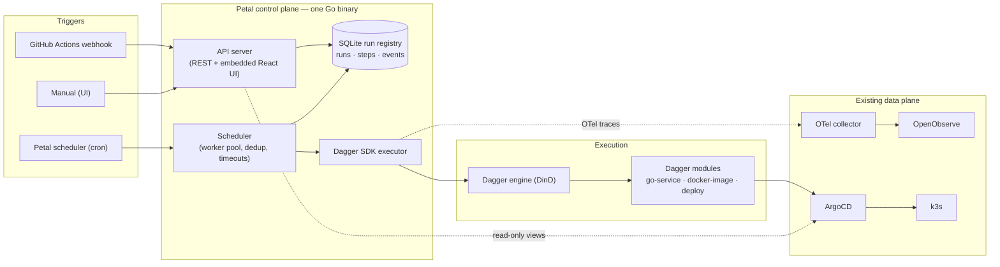

# ADR 0001: Petal architecture — control plane over a Dagger execution layer

Date: 2026-09-06
Status: Accepted (execution layer superseded by [ADR 0002](0002-step-runner.md) —
the Dagger SDK executor was replaced by the first-party step-runner; all other
decisions stand)

## Context

Petal replaces Backstage as the homelab's internal developer platform. Requirements:
traceability, observability, stability, parallelism, pipeline flexibility, and reliability.
Prior pain points from the Backstage deployment: PostgreSQL wipe-on-upgrade migrations,
CORS proxying for every integrated tool, plugin version churn.

Core principle: **Dagger executes, Petal decides and remembers.**
Petal is a control plane (scheduler, run registry, health reporter, UI); pipelines run as
independent Dagger modules; GitHub Actions remains the external trigger layer; ArgoCD
remains the deploy layer; OpenObserve (via the existing OTel collector) is the telemetry sink.

## Decisions

| # | Decision | Rationale (maps to requirement) |
|---|----------|--------------------------------|
| D1 | Single static Go binary serving API + embedded React UI (`go:embed`) | Stability: kills the CORS bug class and reduces the moving parts to one container |
| D2 | SQLite (WAL mode, pure-Go driver `modernc.org/sqlite`) as the run registry | Stability/reliability: no database pod, no migration wipes; append-only events survive crashes |
| D3 | Pipelines as independent Dagger modules under `pipelines/`, invoked generically (module + function + args) | Flexibility: new language/toolchain = new module, zero Petal changes |
| D4 | Dagger Go SDK from the executor; engine via DinD sidecar (pattern proven by ARC runners) | Parallelism + isolation; containers make steps idempotent |
| D5 | Traceability spine: `trigger → run ID → OTel trace ID → ArgoCD sync` stored on every run | Traceability: one ID family joins UI, logs, traces |
| D6 | Worker pool over a persistent queue; per-pipeline concurrency limits; queue depth is a metric | Parallelism with visible backpressure; queue survives restarts (reliability) |
| D7 | At-least-once triggers with dedup keys; per-run timeouts; panic isolation | Reliability |
| D8 | OTel SDK in Petal + native Dagger traces → existing OTel collector → OpenObserve | Observability with zero new infra; graceful degradation if collector is down |
| D9 | Go module at repo root, `main.go` + `internal/` at root, `web/` at root | go:embed cannot traverse parent dirs; keeps `npm run build` → `go build` with no copy steps |
| D10 | Develop on Windows 11, deploy to Debian k3s; `.gitattributes` forces LF | Pure-Go SQLite driver means `CGO_ENABLED=0` static builds cross-compile cleanly; LF avoids CRLF drift on Linux manifests |

## Architecture

## Consequences

- Single-replica in v1; SQLite → Postgres migration is the escape hatch if HA is ever needed.
- Pre-1.0 Dagger SDK churn is absorbed by pinning the SDK version per module and upgrading deliberately.
- The UI must be built (`npm run build`) before `go build`; a committed placeholder in
  `web/dist/index.html` keeps the tree compilable before the first frontend build.
- Phase A ships a stub executor behind the `executor.Executor` interface; the Dagger
  executor is a drop-in replacement (no scheduler/API changes).
- Phase B interim: pipelines are Go functions in an executor registry
  (`internal/executor/dagger.go`, host SDK) rather than standalone modules — the
  dagger CLI is not yet standard in the toolchain. Standalone modules under
  `pipelines/` remain the target form; see `pipelines/README.md`.
- The Dagger engine requires a container runtime at execution time. A missing
  runtime fails the run cleanly (recorded, retriable) — it must never hang or
  crash the scheduler. Verified: engine-down runs fail at the SDK connect
  timeout with a clear error in the registry.

## Phases

- **A — walking skeleton**: binary + UI + registry + manual trigger + stub executor
- **B — brains**: GHA webhook receiver, cron scheduler, dedup, retries
- **C — senses**: OTel wiring, health dashboard, metrics
- **D — catalog**: ArgoCD/K8s views, scorecards, notifications
