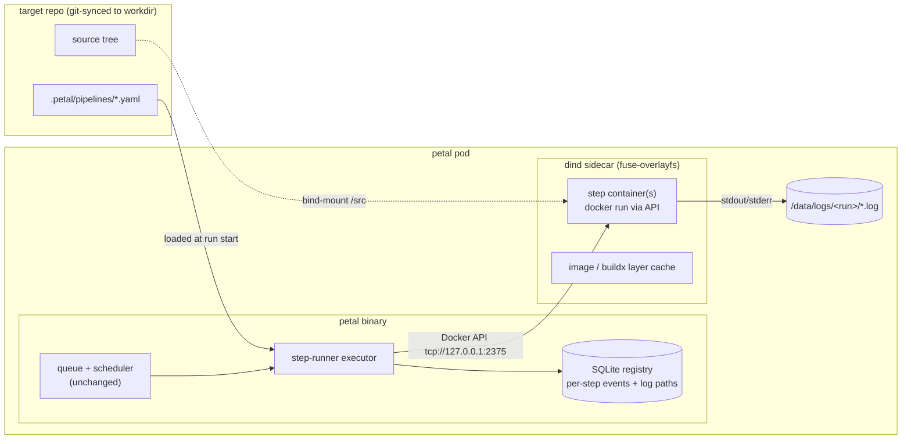

# ADR 0002: Replace the Dagger executor with Petal's own step-runner

**Status:** Accepted (2026-09-07)
**Supersedes:** the Dagger-executor part of [ADR 0001](0001-architecture.md) (D1–D3 wording
about engine provisioning). ADR 0001's other decisions are unchanged.

## Context

Dagger-on-k3s worked but carried a permanent operational tax on this homelab:

- Engine provisioning requires a native-Linux docker host; inside k3s it needs the
  DinD sidecar, where the only viable storage driver was vfs (overlay2-on-overlay is
  rejected) — until the custom `petal-dind` image added fuse-overlayfs.
- The SDK aborts engine provisioning after ~5 min ("timed out waiting for session
  params"); a cold image pull over vfs exceeded that deadline and failed first runs.
- The engine image (646MB under overlay2, >8Gi under vfs) evicted the pod twice.
- Every build pays engine startup; debugging goes through engine logs, not
  copy-pasteable commands.

What the pipelines actually need is narrower than Dagger's feature set: run some
steps in containers against a source tree, stream logs, record what happened.
The `Executor` interface (ADR 0001) keeps execution swappable — so we swap.

## Decision

**Petal gets a first-party step-runner executor.** Pipelines are declarative YAML
files that live **in the repository being built** (`.petal/pipelines/*.yaml`), and
petal executes each step as a plain Docker container against `DOCKER_HOST`
(the DinD sidecar), streaming logs to disk and recording per-step audit events.

Principle restated: **Petal decides and remembers; Docker runs; YAML describes.**



### Pipeline spec (v1)

```yaml
# .petal/pipelines/docker-image.yaml
name: docker-image        # defaults to filename
description: Build and publish the project container image

params:                   # trigger args are validated against these
  ref:
    default: ttl.sh/petal-${PETAL_RUN_ID}:1h
    required: false

steps:
  - name: build
    image: docker:27-cli
    run: |                           # POSIX sh, fail-fast (set -eu injected)
      docker buildx build --push \
        -t "$PARAM_REF" /src

outputs:                             # files the steps must produce
  image-ref: .petal-out/image-ref.txt
```

Rules:

- **Sequential, fail-fast** execution in v1. No DAG — if a pipeline needs one,
  the Dagger executor returns for that pipeline (same interface).
- Each step: fresh container from `image`, workspace bind-mounted at `/src`
  (read-write, shared across steps), `run` executed with `sh -eux`.
- **Environment injected into every step:** all `params` as `PARAM_*` (after
  default substitution), plus `PETAL_RUN_ID`, `PETAL_PIPELINE`, `PETAL_STEP`,
  `PETAL_TRIGGER`, `PETAL_ARGS_JSON`, and `DOCKER_HOST` for image-building steps.
- **Outputs:** files listed in `outputs` are read after success and recorded as
  the run's structured `output` event (replaces the Dagger blob).
- **Logs:** full stdout/stderr streamed to `/data/logs/<run_id>/<step>.log`;
  the `step.finished` event records byte count and exit code. Log retrieval via
  `GET /api/runs/{id}/logs/{step}`.
- **Validation at load:** unknown fields rejected, `run` non-empty, images
  pinned by tag (digest recommended, never `latest` for non-dev steps).

### Execution engine

- `github.com/docker/docker/client` against `DOCKER_HOST` (pure Go, keeps
  `CGO_ENABLED=0`). No docker CLI dependency, no engine binary.
- Container lifecycle: create → start → stream logs (Hijack) → wait → remove.
- Cancellation: the pool's run context cancels → container kill (`SIGKILL`
  after grace) → step fails with `canceled`.
- Workspace: `/data/work/<run_id>/` on the existing PVC — survives restart,
  garbage-collected when the run is finalized (keep last N runs' logs+work).

### What stays / what goes

| | |
|---|---|
| **Stays** | scheduler, queue, dedup keys, cron, webhook, registry schema + events, UI shell, DinD sidecar (fuse-overlayfs image), git-sync sidecar, `Executor` interface, stub executor |
| **Goes** | `internal/executor/dagger.go`, dagger Go SDK dependency, engine pre-pull postStart hook, ttl.sh dogfood special-casing |

### Reusability story

- Any repo gets pipelines by committing `.petal/pipelines/*.yaml` — zero petal
  config needed; petal discovers them from the workdir.
- YAML anchors cover intra-file reuse in v1; `.petal/steps/*.yaml` shared step
  library with `uses:` references is v2 (schema reserved: `uses:` wins over `image`+`run`).
- A `petal pipelines` CLI subcommand (v2) can scaffold pipelines per language.

## Consequences

- **Positive:** no engine, no SDK version drift, no 5-min provisioning deadline,
  no engine image on disk, steps debuggable by hand (`docker run` with the same
  args), per-step audit trail (better than the old blob), pipelines are
  repo-native and portable, one less dependency in go.mod.
- **Negative / accepted:** no content-addressed step caching (buildx keeps image
  layer caching; step-level caching deferred), sequential v1, pipelines are
  trusted code — same privilege as the DinD sidecar (documented trust boundary:
  whoever can trigger a run can execute containers on the worker).
- **Migration:** `-executor steps` becomes the default for the k3s deployment;
  `-executor dagger` removed. Deployed manifest updated accordingly.
